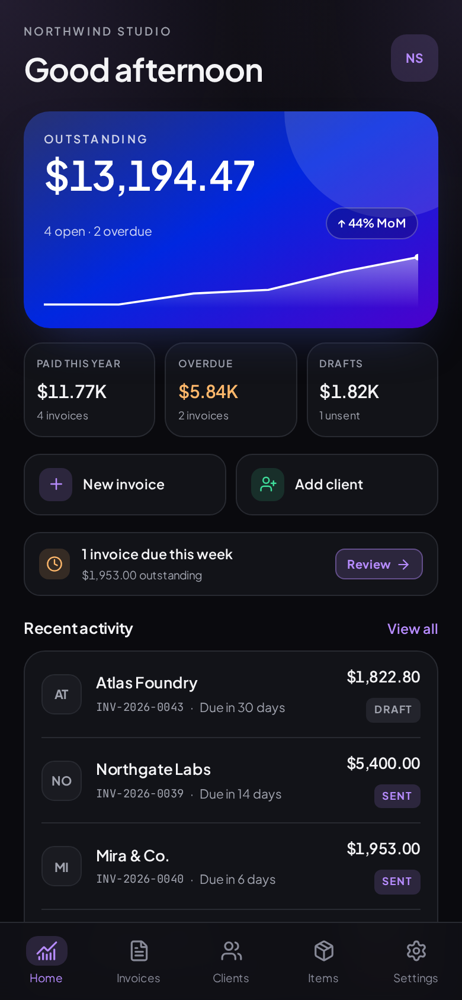

# Billfold

Offline-first invoice generator for Android and the web. **Slate** design direction:
dark, gradient hero, mono figures, status rails. No account, no server, no telemetry,
no haptics.



## Features

**Invoicing**
- Drafts -> issued -> partially paid -> paid, plus overdue and void
- Line items with quantity, unit price, unit, per-line discount and per-line tax rate
- Invoice-level percentage or fixed discount, shipping, multi-currency
- Per-rate tax breakdown (mixed rates supported), proportional discount allocation
- Partial payments ledger, mark-as-paid, automatic balance and status
- Duplicate, void and delete; client details are snapshotted onto each invoice
- Auto numbering (`INV-2026-0043`) with prefix, year toggle and editable counter

**PDF**
- Real vector A4 PDFs generated on-device with `pdf-lib`: three layouts
  (`modern`, `classic`, `minimal`), live in-app preview, embedded logo, brand accent
- DRAFT / VOID watermark, per-page footer, pagination for long invoices
- Save to `Documents/Billfold/` on Android, native share sheet, browser download on web
- Files are 2-5 KB and render in every PDF viewer (standard Helvetica, WinAnsi-safe)

**Appearance**
- Light, dark or system mode, applied instantly and persisted on device
- 10 themes: Slate Indigo plus the nine supplied palettes (5 dual-tone, 4 triple-tone)
- 5 bundled typefaces: Plus Jakarta Sans, Satoshi, Outfit, Geist Sans, Cabinet Grotesk
- Every theme is generated from its palette at runtime (surfaces, borders, states, hero
  gradient) and audited for WCAG contrast in both modes

**Data**
- Clients with contact, address, VAT ID, currency and payment terms
- Reusable catalog of products/services with SKU, unit, default price and tax
- Business profile: logo, address, VAT, bank details, accent colour
- Settings: currency, locale, date format, tax default, terms, PDF template
- JSON export / import, automatic on-device snapshots, demo data, erase-all

**Android**
- True edge-to-edge with window insets applied natively (`SystemBars`, `insetsHandling: native`),
  so scrolling content can never slide under the status bar or behind the nav bar
- Hardware back button: sheet/dialog -> keyboard -> editor (discard guard) -> parent screen ->
  "Exit Billfold?" confirmation
- Filesystem + share sheet + keyboard-aware insets; no vibration/haptics anywhere
- Launcher icon, adaptive icon and splash generated from the in-app brand mark

## Stack

| Layer | Choice |
| --- | --- |
| UI | Vue 3.5 (`<script setup>`, TypeScript), custom design system on CSS variables |
| Build | Vite 8 (rolldown), lazy-loaded PDF chunk |
| State | Pinia 4 setup stores |
| Storage | Dexie 4 on IndexedDB: transactional, indexed, blob-capable |
| PDF | pdf-lib (pure JS, no native step) |
| Native | Capacitor 8: app, filesystem, share, splash-screen, keyboard + built-in SystemBars |
| Theming | runtime CSS custom properties generated from palette + mode |
| Icons | `@lucide/vue` |

## Why IndexedDB (Dexie) instead of SQLite

The requirement was "offline, on device, no surprises". IndexedDB gives us:

- **One storage engine on every platform** - the Android WebView and desktop browsers
  run the exact same code path, so behaviour cannot diverge between web and APK.
- **Transactions and indexes** for the queries this app needs (status, due date,
  client, updated-at). Dexie's schema versioning handles future migrations.
- **No extra native plugin** - nothing to compile, register, or break during a
  Capacitor upgrade; the APK stays small.
- **Large values** (a base64 logo) fit comfortably, unlike `localStorage`.

`navigator.storage.persist()` is requested at boot so the OS treats the database as
durable. On Android, JSON snapshots are also written to `Documents/Billfold/backups/`
and can be re-imported from Settings - so even a wiped WebView store is recoverable.
The data layer lives in `src/db/db.ts` and `src/stores/*`; swapping Dexie for SQLite
later only touches those files.

## Offline behaviour

- No network requests at runtime: no remote fonts (Inter and JetBrains Mono are
  bundled), no analytics, no API calls. Totals, stats, PDFs and backups are local.
- `android:usesCleartextTraffic="false"`; the app works in airplane mode.
- The manifest keeps `INTERNET` because Capacitor serves the app over a local scheme,
  but the app never calls out.

## Develop

```bash
npm install
npm run dev            # http://localhost:5173 (hash routing)
npm run typecheck      # vue-tsc
npm run build          # dist/ + lazy pdf chunk
```

## Appearance & themes

Settings -> Appearance switches colour mode, palette and typeface. Nothing is hardcoded
per component: `src/lib/themes.ts` turns a palette into the full token set
(`--bg`, `--surface*`, `--line*`, `--ink*`, `--accent*`, state colours, hero gradient,
chrome, scrim, glow) for the active mode, and `applyAppearance()` writes it onto
`<html>`. Switching mode also restyles the Android status bar icons.

| Theme | Palette |
| --- | --- |
| Slate Indigo | `#1B2350` · `#7C93FF` · `#B78CFF` |
| Classic Corporate | `#1E2761` · `#408EC6` |
| Energetic Retail | `#2C3E50` · `#E67E22` |
| Eco-Organic | `#2C5F2D` · `#97BC62` |
| Cyber High-Contrast | `#1A1A1A` · `#C1DD13` |
| Minimalist Editorial | `#CC313D` · `#F7C5CC` |
| The High-End Trio | `#1E2761` · `#408EC6` · `#7A2048` |
| The Bright Tech Vibe | `#2D3047` · `#2EC4B6` · `#FF7A59` |
| The Playful Pastel | `#B298E7` · `#B8E3E9` · `#F5B8D5` |
| The Earthy Muted | `#4A5842` · `#EFEBE4` · `#D98A6C` |

Modes: light, dark, system. Fonts are vendored as woff2 (OFL for the Google families,
free Fontshare licence for Satoshi and Cabinet Grotesk) so the app stays fully offline.

### Pickers

Native `<select>` popups are rendered by the WebView with a transparent window on Android,
which is why the invoice-default dropdowns looked broken. Every select is now an
`AppSelect` component: a field that opens an in-app bottom sheet with the options, a tick
on the current value and the same look in both themes. No native dropdowns remain.

## Android

Requires JDK 17 and the Android SDK (compileSdk 36, minSdk 24).

```bash
npm run cap:sync                  # build web + copy into android/
npx cap open android              # Android Studio
npm run android:build             # gradlew assembleDebug -> android/app/build/outputs/apk/debug/
```

Native configuration lives in `capacitor.config.ts` (app id `studio.billfold.app`,
splash colours, `SystemBars` inset handling, keyboard) and
`android/app/src/main/res/values/styles.xml` (dark theme, splash, system bars).

### Status bar / insets

Android 15+ enforces edge-to-edge for apps targeting SDK 35+, and the legacy
`@capacitor/status-bar` overlay API no longer changes layout there. Billfold therefore:

1. draws edge-to-edge (`WindowCompat.setDecorFitsSystemWindows(window, false)` in
   `MainActivity`, transparent bars),
2. lets Capacitor 8's built-in **SystemBars** plugin measure the status bar, navigation bar,
   cutout and IME insets and apply them as window padding (`insetsHandling: 'native'`),
3. keeps the web layer out of window layout entirely - it never calls overlay APIs and the
   CSS `env(safe-area-inset-*)` values stay `0` because `viewport-fit=cover` is intentionally
   absent.

The result is a single source of truth for insets: content is clipped above the status bar,
the tab bar sits above the gesture/navigation area, and the keyboard shrinks the page
without double spacing. `SystemBars` also sets light icons on the dark theme from config,
so no runtime status-bar calls are needed.

> Authored in an environment without a JDK/Android SDK, so the APK itself was not
> compiled here. The web build, `cap sync`, Gradle config, resources and manifest are
> in place and verified as far as the tooling allowed.

## Project layout

```
src/
  db/            Dexie schema, backups, demo data
  lib/           money (integer minor units), dates, totals engine, PDF, native bridge
  stores/        settings, data, ui (toasts, confirm, sheet stack for back button)
  components/    shell pieces, sheets, invoice preview, forms
  views/         dashboard, invoices, editor, detail, clients, catalog, settings
  styles/        design tokens + component styles
android/         Capacitor Android project (themed, icons, splash)
mockups/         the four design directions + screenshots of the shipped app
tools/           screenshot / QA scripts (Playwright, PDF rendering)
```

Money is stored as integer minor units end-to-end (with per-currency exponents for
JPY/KRW/KWD), so totals never drift. `src/lib/calc.ts` is the single source of truth
for discounts, tax and balances.

## QA

Headless runs against the production build (`vite build` + static server):

```bash
cd tools/shots
node app-test.mjs     # screenshots + PDF download + persistence + issued flow
node flows-test.mjs   # 3 templates, payment, client CRUD, draft save, settings, filters
node back-test.mjs    # Android back order: exit prompt, parent route, sheet, blur, discard guard
node select-test.mjs  # every custom picker: settings, editor, catalog, clients + persistence
node theme-test.mjs   # screenshots of all 10 themes in both modes and all 5 fonts
node theme-audit.mjs  # WCAG contrast audit for each theme/mode (fails under 3:1)
node pdf-check.mjs /tmp/billfold-test.pdf   # page text + PNG render of the PDF
```

Latest results: 11 invoices persisted across reload, payments recalculate balances,
all three PDF templates render with correct text, zero console errors.

## No haptics

`@capacitor/haptics` is not a dependency, no `navigator.vibrate` calls exist, and the
Android manifest requests no vibration permission.
